<div align="center">

# 🏥 MediAgent

**Medical AI Platform · POC Baseline v1.1**

[](https://www.python.org/)
[](LICENSE)
[](#-tests)
[](#-quick-start)
[](#-poc-boundaries-an-honest-scope)
[](deploy/docker-compose.yml)

[中文](README.md) | **English**

</div>

> Turns "can this AI app go clinical?" from a fuzzy argument into an **evaluable, approvable, rollback-able, auditable** pipeline.
> App factory → knowledge governance → model gateway → eval gate → two-stage approval → patient app, every step logged.

A medical AI platform POC that runs on **zero third-party dependencies**: Python stdlib + SQLite for the server, native ES Modules for the frontend, a WeChat Mini Program for the patient side.

> ⚠️ This is a POC / pilot-preparation system, not a production or registered medical product. See [POC boundaries](#-poc-boundaries-an-honest-scope).

---

## ✨ Capabilities

| Module | What it does |
|---|---|
| 🔐 Identity & RBAC | Server-issued token sessions (8h), role × department × app ownership, separation of approval duties; **`X-User-Id` is rejected as identity** |
| 🏭 App factory | 3 templates (knowledge QA / record QC / report draft), create & configure, trial runs (output + citations + disclaimer + versions + degradation) |
| 💬 Run debugger | Conversational trial runs, execution trace (template → memory → knowledge/rules → model → safety), 👍/👎 feedback auto-files BadCase |
| 📚 Knowledge center | Import / review / versioning / effective windows / scope permissions + FAQ; expired and pending items never retrieved; citations verifiable |
| 🔄 Source sync | Register file / JSON / URL sources → incremental sync as `pending` → effective only after review; paths confined to `data/` |
| 🧠 Long-term memory | 3 scopes (user/agent/tenant) × 4 types, dedup, soft/hard delete, 64-dim vector search, session/auto write modes |
| 🔌 Model gateway | Model registry, policy chains, timeouts, explicit degradation flags, call logs; never fabricates results when upstream is down |
| 📊 Eval gate | Datasets, metrics (recall / citation / correctness / fabrication / detection), thresholds, `409` blocks release when unmet |
| ✅ Two-stage release | Department → platform approval; release writes an immutable version snapshot; disable and rollback supported |
| 🩺 Report editor | Draft generation → physician edit → sign → edit-rate tracking → audit; signed reports are immutable |
| 🔗 Integrations | HIS / EMR / PACS **mock**: patient context aggregation, signed-report write-back (idempotent + external ID + audit) |
| 📱 Patient mini program | WeChat login → bind → reports (approved only) → follow-ups → red-flag escalation; data isolated per binding |
| 🚨 Medical AI safety | Forbidden output (diagnosis / prescriptions / unsafe advice) auto-blocked with safety events and human handoff; no fabricated output on model failure |
| 🧾 Audit hash chain | Every audit row carries a SHA-256 chain hash (`prev_hash`); `/api/audit/verify` detects tampering and broken links |
| 📈 Ops dashboard | 10 metrics (definition + source + current value), cost reconciliation, WeCom / DingTalk alert webhooks |
| 🐳 Production Stage 1 | FastAPI edge + Docker/Compose + `/healthz` `/readyz` + security headers + token-bucket rate limiting + backup scripts + TLS reverse-proxy template |

---

## 📸 Screenshots

| Login | Dashboard / acceptance |
|---|---|
| 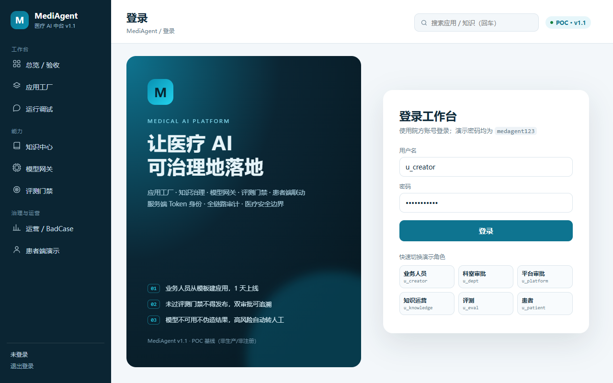 | 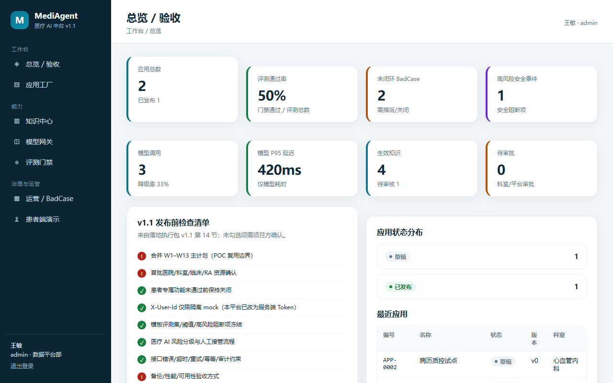 |

| App factory | App detail (gate + approvals) |
|---|---|
| 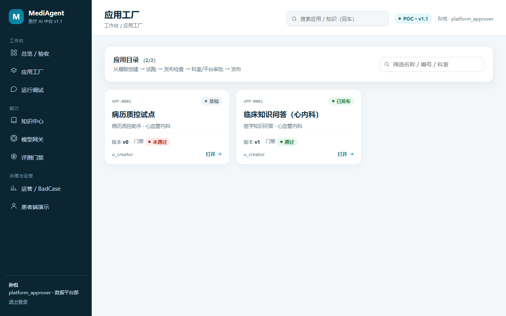 | 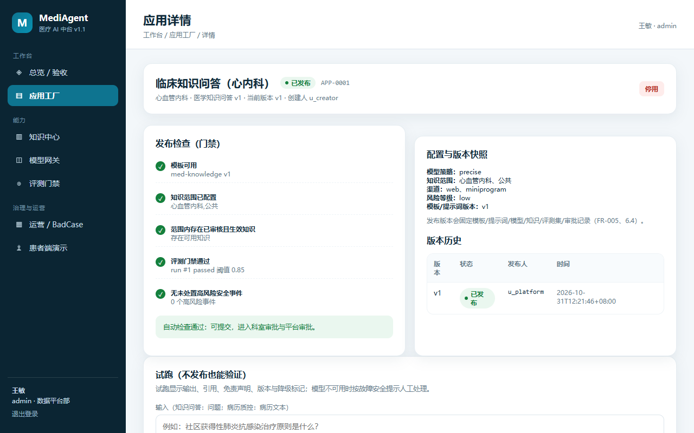 |

| Run debugger (chat + trace) | Model gateway |
|---|---|
| 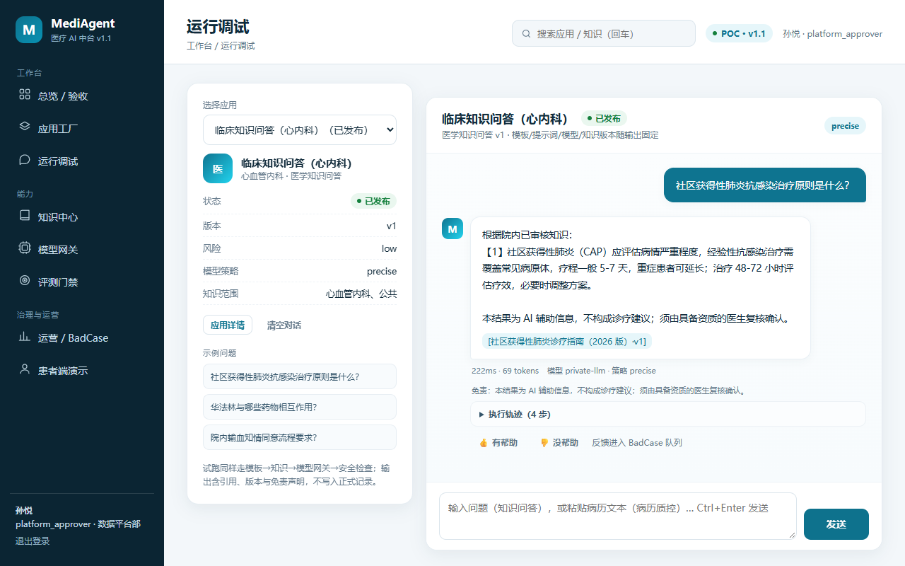 | 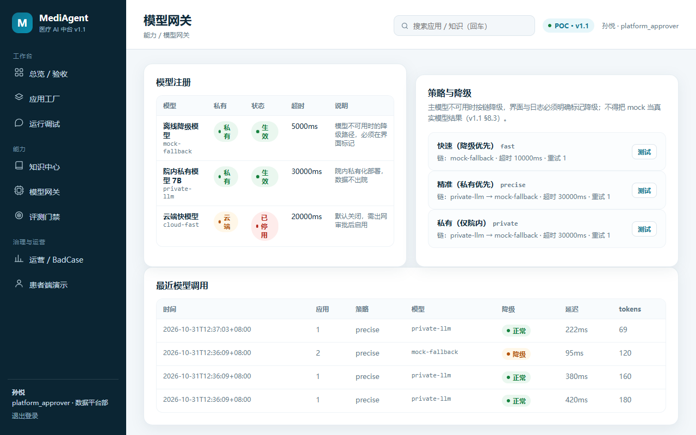 |

| Ops / BadCase | Knowledge center |
|---|---|
| 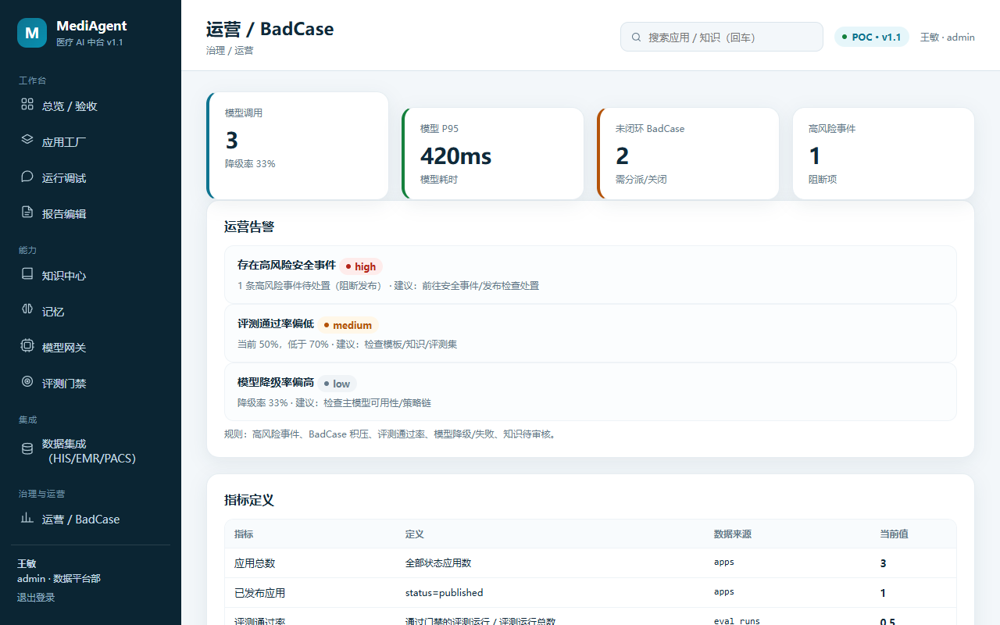 | 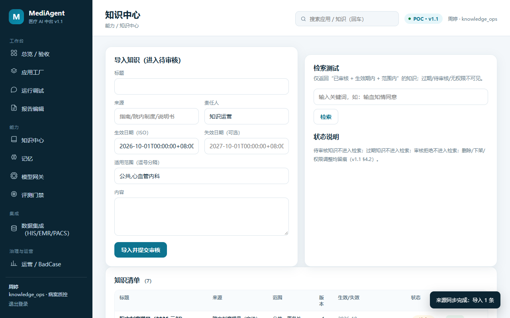 |

| Long-term memory (scopes / injection) | Patient side (mini program) |
|---|---|
| 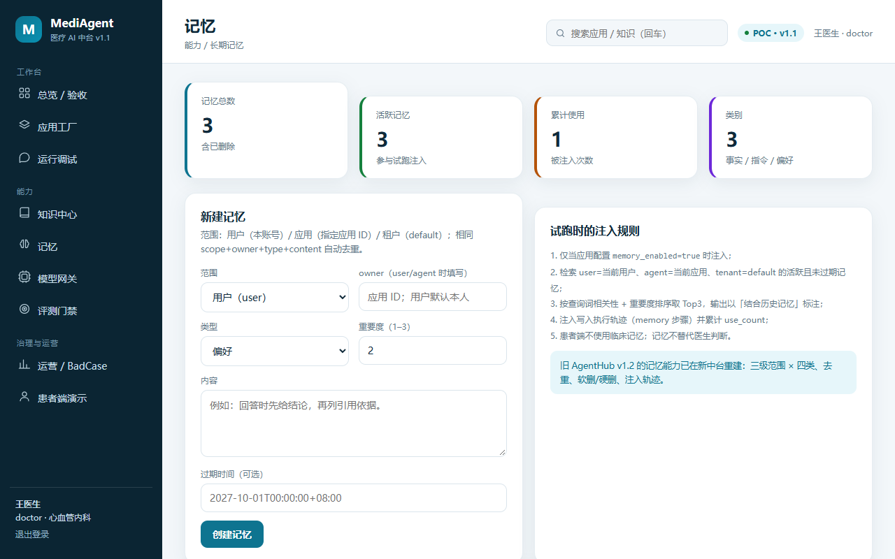 | 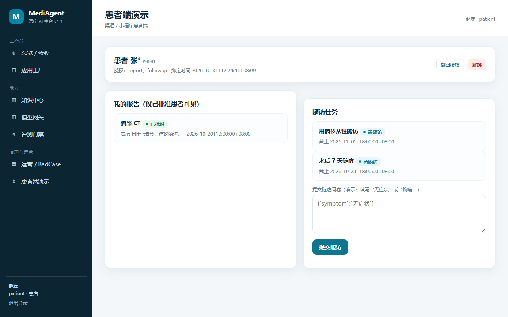 |

| Report editor (draft → sign) | Integrations (HIS/EMR/PACS mock) |
|---|---|
| 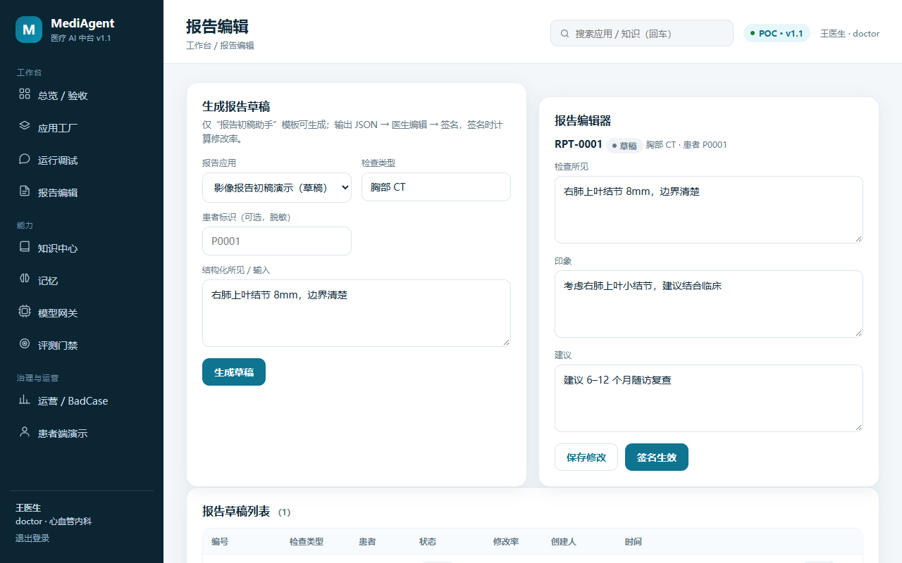 | 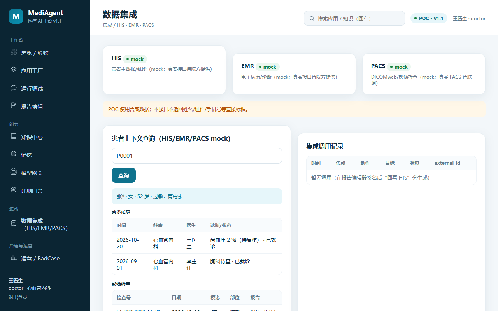 |

---

## 🚀 Quick start

Requires **Python 3.12+**. The core has zero third-party dependencies.

```bash
cd medagent-platform
python server/app.py --port 8090 --db data/medagent.db --reset
# open http://127.0.0.1:8090
```

First launch creates the database and seeds synthetic data (32 tables / 8 accounts / 3 templates / 6 knowledge docs + 4 FAQs / 3 apps / 2 patients).

Windows: `scripts/start.ps1`. Linux/macOS: `scripts/start.sh`.

### 👤 Demo accounts

Password for all accounts: `medagent123`.

| Account | Role | Purpose |
|---|---|---|
| `u_creator` | Business user | Create apps from templates, trial run, submit for release |
| `u_dept` | Department approver | Department-level approval (own department) |
| `u_platform` | Platform approver | Platform approval, publish, rollback, disable |
| `u_knowledge` | Knowledge operator | Knowledge import / review |
| `u_eval` | Evaluator | Run evaluations, inspect gates |
| `u_doctor` | Physician | Trial runs, clinical review, report edit & sign |
| `u_patient` | Patient | Patient side (bind / reports / follow-ups) |
| `u_admin` | Platform admin | Full governance, model switches, audit export |

### 🧪 Tests

```bash
python tests/test_api.py               # 25 API acceptance tests (real process + HTTP)
python tests/test_llm_live.py          # 3 live-model upstream tests (fake OpenAI-compatible upstream)
python tests/test_dify.py              # 4 Dify adapter tests (fake Dify)
python tests/test_notify.py            # 4 alert notification tests (fake webhook)
python tests/test_rate_limit.py        # 2 token-bucket rate-limit tests
python tests/test_pg_compat.py         # 7 PG runtime translation tests (1 real-PG test skipped)
python tests/test_pg_migration.py      # 3 SQLite → PostgreSQL migration & reconciliation tests
python tests/test_production_import.py # 2 FastAPI edge import tests (skipped without fastapi)
```

**50 tests, all passing.** Or run `scripts/check.sh` / `scripts/check.ps1` (tests + frontend JS syntax).

### 🐳 Containerized

```bash
docker compose -f deploy/docker-compose.yml up -d --build
curl http://127.0.0.1:8080/healthz   # {"status":"ok",...}
curl http://127.0.0.1:8080/readyz    # {"status":"ready","db":"sqlite"}
```

Single worker with a SQLite persistent volume; horizontal scaling requires the PostgreSQL migration first. See [production deployment](docs/production-deployment.md).

---

## 🏗 Architecture

```
Browser (native ES Module SPA, no build step)
        │  JSON / Bearer Token (X-User-Id rejected)
        ▼
server/app.py (zero-dependency HTTP: static hosting + API router + token middleware)
  ├─ auth.py              login / sessions / permissions
  ├─ templates.py         3 POC templates (prompts / config / thresholds)
  ├─ apps.py              app factory, trial runs, release checks, two-stage approval, publish / rollback / disable
  ├─ knowledge.py         knowledge import / review / versioning / effective windows / retrieval
  ├─ knowledge_sources.py source registration & incremental sync (file/json/url)
  ├─ models.py            model registry, policy chains, degradation, call logs
  ├─ eval_center.py       datasets, metrics, gates, results
  ├─ memory.py            long-term memory (scopes / dedup / vector search / trial injection)
  ├─ engine.py            generation engine (template + retrieval + safety + gateway)
  ├─ safety.py            forbidden output, risk blocking, human handoff
  ├─ reports.py           report draft / edit / sign / edit rate
  ├─ integrations.py      HIS/EMR/PACS mock and report write-back
  ├─ dify_adapter.py      Dify app registration and blocking calls
  ├─ ops.py               metric definitions, BadCase, audit hash chain
  ├─ patient.py           patient binding / authorization / reports / follow-ups / handoff
  ├─ wechat.py            WeChat login (real jscode2session / dev mock)
  ├─ ratelimit.py         token-bucket rate limiting (429 + Retry-After)
  ├─ pg_compat.py         PG runtime compatibility layer (experimental)
  └─ seed.py              synthetic seed data
production/               FastAPI production edge (reuses server/handlers.py)
deploy/                   Dockerfile, Compose, TLS reverse proxy, backup scripts, PG migration plan
web/                      index.html + app.css + app.js (no build step)
miniprogram/              patient mini program (import into WeChat DevTools)
tests/                    50 tests (real process / fake upstreams)
docs/                     API contract, requirements mapping, deployment, load-test baseline
```

**Stack**: Python stdlib (`http.server`, `sqlite3`, `hashlib`) + native ES Modules + WXML/WXSS.
**Storage**: SQLite, 32 tables. FastAPI/Uvicorn is used only at the production edge; `psycopg` is optional for the migration tool.

---

## 🔍 Key flows

**1. Create and release an app**

```
u_creator creates app (draft) → trial run (output + citations + disclaimer + versions + degradation)
   → submit → automatic checks (template / knowledge scope / available knowledge / eval gate / high-risk safety events)
   → blocked: 409 release_blocked with per-item reasons
   → department approval → platform approval → immutable version snapshot → published
   → disable / rollback (restores config, consistent with the displayed version)
```

**2. Knowledge governance**

```
import (source / version / effective / expiry / scope) → pending (never retrieved) → approved (retrievable)
   → expired items drop out of retrieval automatically; every action audited
```

**3. Patient side**

```
WeChat login (dev mock) → bind (patient ref + verification code 654321) → authorize
   → reports (only approved_for_patient=1) → submit follow-up
   → red flags (chest pain / dyspnea / bleeding) → human handoff task + seek-care guidance
   → revoke authorization / unbind supported; patient data isolated per binding
```

**4. Model failure safety**

```
policy chain (private-llm → mock-fallback)
   → primary disabled: auto-degrade with explicit degraded flag
   → all unavailable: refuse definitive conclusions + hand off to a human, never pass mock off as real
```

---

## 📡 API overview

Auth: everything except `/api/health`, `/api/auth/login`, `/api/auth/wx-login` requires `Authorization: Bearer <token>`.
Errors: `{"error":{"code":"...","message":"...","details":[...]}}`, no stack traces.

| Method | Path | Description |
|---|---|---|
| POST | `/api/auth/login` | Login, returns Bearer token |
| POST | `/api/auth/wx-login` | WeChat login (real / mock) |
| GET/POST | `/api/apps` | List / create apps |
| POST | `/api/apps/{id}/trial` | Trial run (output / citations / versions / trace / auto memory) |
| POST | `/api/apps/{id}/feedback` | Feedback (unhelpful → BadCase) |
| GET | `/api/apps/{id}/release-check` | Per-item pre-release checks |
| POST | `/api/apps/{id}/submit` | Submit for release (enters department approval) |
| POST | `/api/approvals/{id}/decide` | Approve / reject (department → platform) |
| GET/POST | `/api/knowledge`, `/api/faqs` | Knowledge / FAQ list and import |
| GET | `/api/knowledge/search?q=` | Retrieval (effective + approved + in scope only) |
| GET/POST | `/api/knowledge/sources` | Register / sync knowledge sources |
| GET/POST | `/api/memories` | List / create memories |
| GET | `/api/memories/search?q=&mode=vector` | 64-dim vector / keyword search |
| POST | `/api/eval/run` | Run evaluation (gate decision) |
| GET | `/api/ops/metrics`, `/api/ops/costs?days=30` | Metric definitions / cost reconciliation |
| GET | `/api/audit`, `/api/audit/verify` | Audit query / hash-chain verification |
| POST | `/api/integrations/report-writeback` | Signed report write-back to HIS (idempotent) |
| GET/POST | `/api/patient/*` | Bind / reports / follow-ups |

Full contract: [`docs/api-contract.md`](docs/api-contract.md) (Chinese).

---

## ⚠️ POC boundaries (an honest scope)

This is a **POC / pilot-preparation** system, **not a production or registered medical product**:

- 🧪 AI output comes from templates / rules plus a simulated model — **not a real clinical model**, and is never used for diagnosis or treatment decisions;
- 🚫 Not implemented: real Dify / RAGFlow deployment, real HIS/EMR/PACS interfaces, TLS audits / compliance certification, KMS, production PostgreSQL, K8s, SSO/MFA, real clinical validation;
- 💬 WeChat login defaults to **dev mock**; real use requires `WX_APPID` / `WX_SECRET`;
- 🗂 All data is **synthetic seed data**; no real patient information is included;
- 🐘 The PG runtime compatibility layer is **experimental** and unverified against a real PostgreSQL instance; the migration tool is complete but the runtime is not wired up;
- 📉 Single worker + SQLite cannot scale horizontally; the load-test baseline covers a local read-only endpoint only — it is not a capacity commitment.

---

## 🔒 Security & compliance

- **Auth**: server-issued tokens (8h), `X-User-Id` never trusted; login / logout / permission checks are all server-side;
- **Permissions**: role + department + app ownership + separation of approval duties;
- **Data**: patient data isolated per binding, reports visible only when approved, patient identifiers minimized;
- **Audit**: critical operations chained with SHA-256 hashes; exports are permission-gated and audited;
- **Safety**: forbidden output is blocked with human handoff; results are never fabricated when the model is unavailable; no stack traces in errors;
- **Secrets**: injected via environment variables / secret managers only; `.env` is never committed and images contain no credentials.

Read the pre-deployment limits in [production deployment · known limitations](docs/production-deployment.md) (Chinese).

---

## 📚 Documentation

| Document | Contents |
|---|---|
| [`docs/api-contract.md`](docs/api-contract.md) | API, error codes, auth and security conventions |
| [`docs/requirements-mapping.md`](docs/requirements-mapping.md) | v1.1 FR / NFR / TBD mapping to code (incl. what is not implemented) |
| [`docs/prd-execution-status.md`](docs/prd-execution-status.md) | Module status and next steps |
| [`docs/production-deployment.md`](docs/production-deployment.md) | Deployment, backup, TLS, boundaries, next stage |
| [`docs/postgres-runtime-switch.md`](docs/postgres-runtime-switch.md) | PG runtime switch (experimental) |
| [`docs/load-test-baseline.md`](docs/load-test-baseline.md) | Local load-test baseline and its limits |
| [`deploy/postgres/README.md`](deploy/postgres/README.md) | SQLite → PostgreSQL migration tool |
| [`miniprogram/README.md`](miniprogram/README.md) | Patient mini program setup |

> The `docs/` files are written in Chinese; this English README summarizes them.

---

## 📄 License

[MIT](LICENSE) © skywalkerqqq
