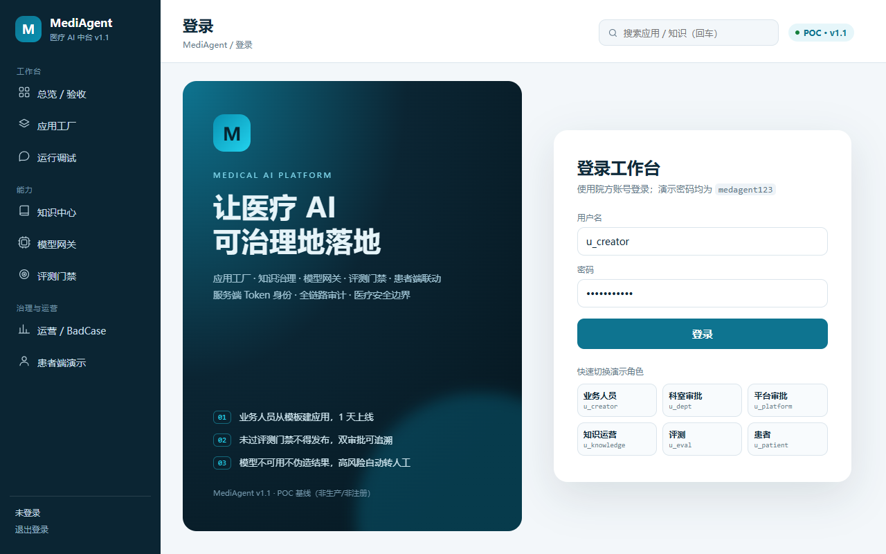
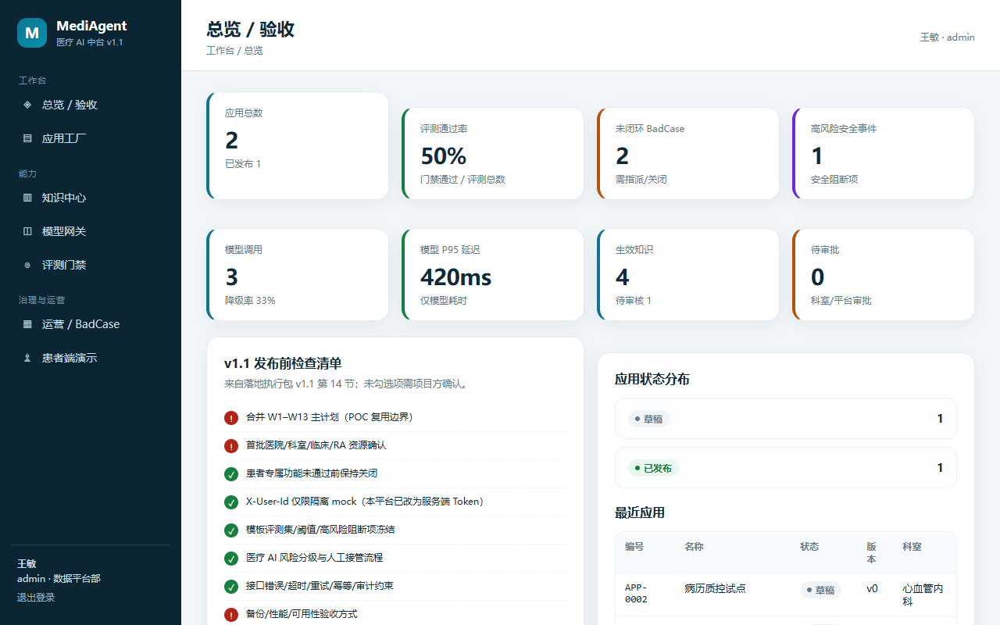
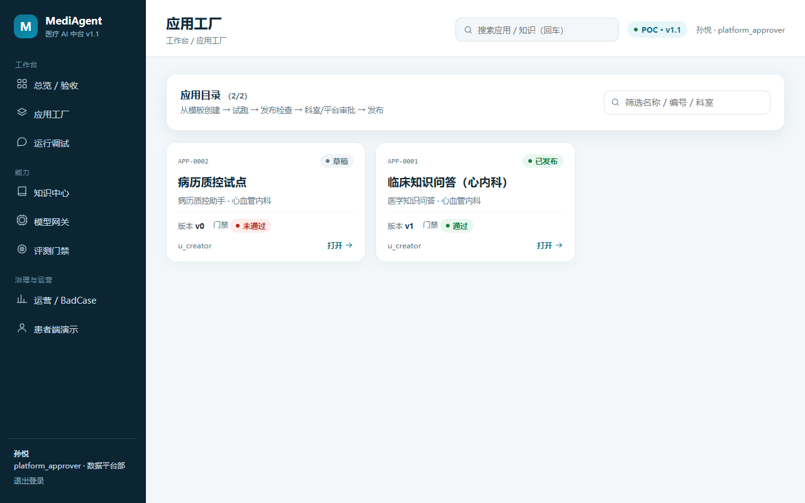
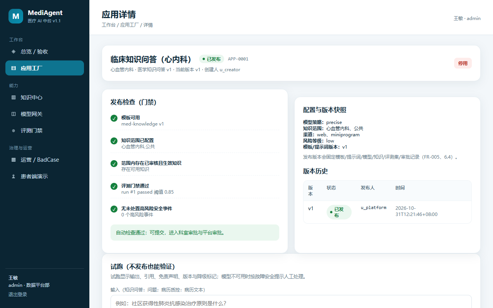
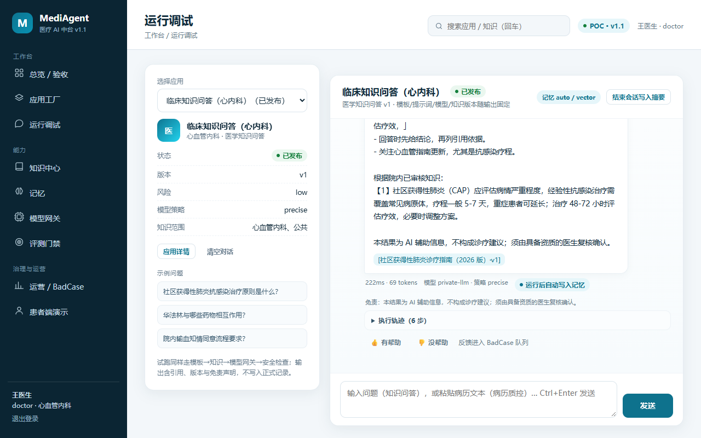
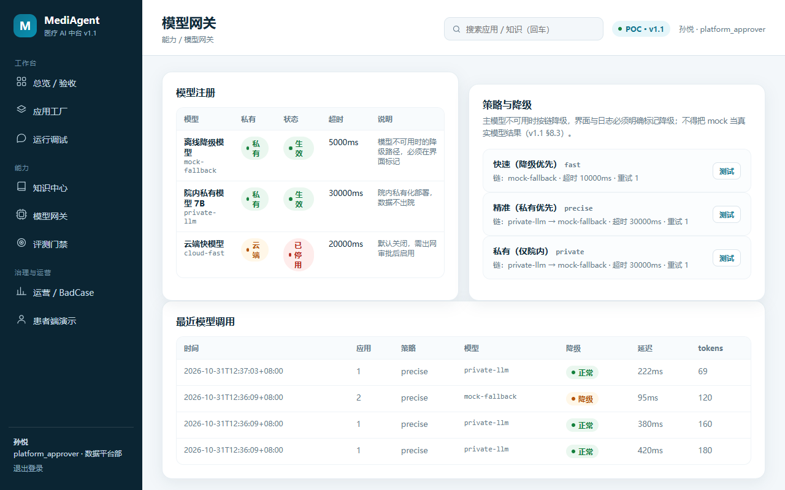
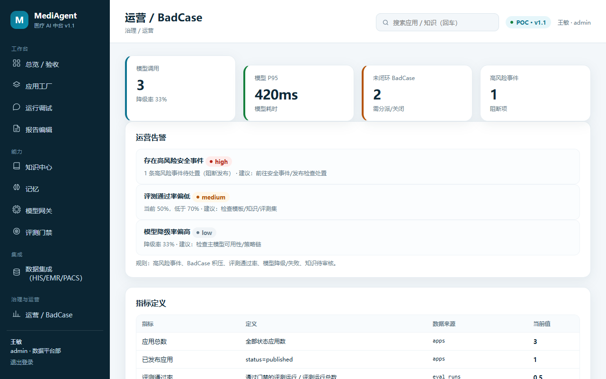
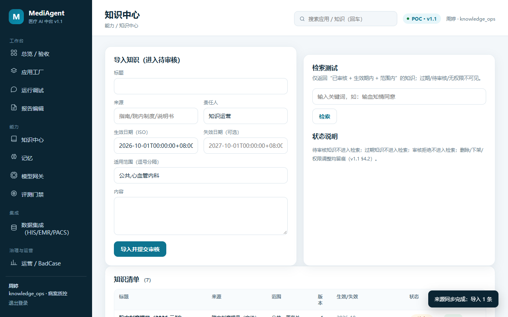
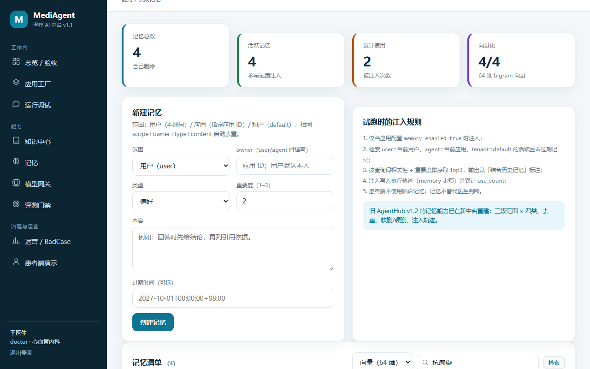
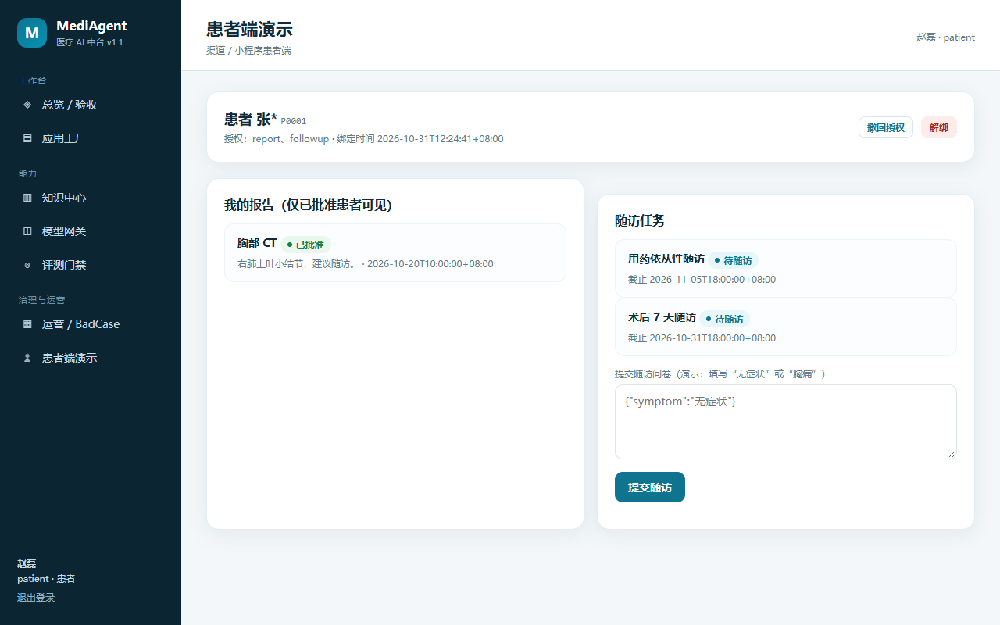

# MediAgent · 医疗 AI 中台 v1.1（独立新实现）

> 依据 `医疗AI中台-落地执行包-v1.1.md` 第五部分「产品需求基线与补充规范」重建的 **POC 级中台**：
> 覆盖应用工厂、知识治理、模型网关、评测门禁、双审批发布、患者端（小程序）联动、BadCase 与审计。
>
> **本工程为全新独立工程，不修改、不复用旧项目目录**（`agent-platform/`、`medical-ai-platform/` 均保持原样）。

---

## 1. 快速开始

环境：Python 3.12（仅标准库 + SQLite，零第三方依赖）。

```powershell
cd medagent-platform
python server/app.py --port 8090 --db data/medagent.db --reset
# 浏览器打开 http://127.0.0.1:8090
```

演示账号（密码均为 `medagent123`）：

| 账号 | 角色 | 用途 |
|---|---|---|
| `u_creator` | 业务人员 | 从模板建应用、试跑、提交发布 |
| `u_dept` | 科室审批人 | 科室级审批（本部门） |
| `u_platform` | 平台审批人 | 平台审批、发布、回滚、停用 |
| `u_knowledge` | 知识运营 | 知识导入/审核 |
| `u_eval` | 评测人员 | 执行评测、看门禁 |
| `u_doctor` | 医生 | 试跑、临床复核 |
| `u_patient` | 患者 | 患者端（绑定/报告/随访） |
| `u_admin` | 平台管理员 | 全量治理、模型开关、审计导出 |

测试：

```powershell
python tests/test_api.py     # 21 项接口验收测试
```

或 `scripts/check.ps1`（测试 + 前端 JS 语法检查）。

---

## 2. 功能总览（对应 v1.1 FR）

| 模块 | 已实现 | 对应 |
|---|---|---|
| 身份 | 服务端 Token 会话（8h）、登录/退出、角色权限；**拒绝 X-User-Id 作为身份** | FR-001 / §8.1 |
| 机构/角色 | 用户-角色-科室；页面/API/数据查询权限校验 | FR-002 |
| 应用工厂 | 2 个模板、创建/配置、试跑（输出+引用+免责+版本+降级） | FR-003 |
| 运行调试（对话式） | 应用选择、对话气泡、引用/版本/免责、执行轨迹（模板→记忆→知识/规则→模型→安全）、👍/👎 反馈→BadCase | FR-003/008/010 |
| 记忆（扩展） | 三级范围 × 四类、去重/软删/硬删、**session 会话结束写摘要 / auto 运行后自动写入**、**64 维 bigram 向量检索**、试跑注入轨迹 | AgentHub v1.2 能力重建（非 v1.1 必需） |
| 运行记录（扩展） | 每次试跑落 runs（应用/用户/输入/降级/记忆写入），运营台可查 | 旧版运行记录能力吸收 |
| 评测门禁 | 评测集、指标（召回/引用/答案正确/编造/检出）、阈值、未达标阻断发布 | FR-004 |
| 审批发布 | 科室→平台两级审批；发布版本快照；停用/回滚；发布人/审批人/版本可追溯 | FR-005 |
| 模型网关 | 模型注册、策略链、超时/降级显式标记、密钥/调用记录；小程序不直连模型 | FR-006 |
| 知识中心 | 导入/审核/版本/生效失效/范围权限；引用可核验；过期/待审不检索 | FR-007 / §4.2 |
| 生成记录 | 每次试跑返回模板/提示词/模型/知识版本快照 | FR-008 |
| 审计 | 登录/建应用/提交/审批/发布/评测/知识/患者/模型/导出全留痕；导出受权限控制 | FR-009 |
| BadCase | 登记、分派、关闭（整改结论）、运营指标 | FR-010 |
| 运营看板 | 指标定义（口径/来源/当前值）、应用状态、安全检查清单 | FR-011 |
| 患者端 | 微信登录（dev mock/真实 jscode2session）、身份核验绑定、授权/撤回/解绑、报告（仅批准可见）、随访、异常转人工、患者隔离 | FR-012 / FR-013 |
| 报告查询 | 仅 `approved_for_patient=1`；未授权不可见 | FR-014（受限） |
| 医疗 AI 安全 | 允许/禁止输出、风险阻断、人工接管提示、模型故障安全、输出不伪造 | §6 |
| 变更控制 | 版本快照固定模板/提示词/模型/知识/评测/审批；回滚恢复配置 | §6.4 |

### POC 边界（诚实说明）

- 这是 **POC/试点准备** 系统，不是生产/注册产品；AI 输出均为模板/规则+模拟模型生成，非真实临床模型；
- 未实现：真实 Dify/RAGFlow 部署、真实 HIS/EMR/PACS 接口、TLS/等保、KMS、PostgreSQL/K8s、真实临床验证；
- 微信登录默认为 **dev mock**；真实微信需配置 `WX_APPID/WX_SECRET`（或 `WX_CODE2SESSION_URL`）；
- 患者端仅演示报告/随访/绑定，不含真实患者数据；所有数据为合成种子数据。

---

## 3. 架构与代码结构

```
浏览器（原生 ES Module SPA）
        │  JSON / Bearer Token（无 X-User-Id 认证）
        ▼
server/app.py（零依赖 HTTP，静态托管 + API 路由 + Token 中间件）
  ├─ auth.py        登录/会话/权限
  ├─ templates.py   两个 POC 模板（提示词/配置/阈值）
  ├─ apps.py        应用工厂、试跑、发布检查、双审批、发布/回滚/停用
  ├─ knowledge.py   知识导入/审核/版本/生效失效/检索引用
  ├─ models.py      模型注册、策略链、降级、调用记录
  ├─ eval_center.py 评测集、指标、门禁、结果
  ├─ memory.py      长期记忆（三级范围/去重/软删硬删/试跑注入）
  ├─ engine.py      生成引擎（模板 + 检索 + 安全 + 网关）
  ├─ safety.py      禁止输出、风险阻断、人工接管
  ├─ ops.py         指标口径、BadCase、审计
  ├─ patient.py     患者绑定/授权/报告/随访/转人工
  ├─ wechat.py      微信登录（真实/ dev mock）
  └─ seed.py        合成种子数据（用户/知识/应用/评测/患者）
web/                 index.html + app.css + app.js（无构建）
tests/test_api.py    21 项验收测试（真实进程 + HTTP）
docs/                需求映射、接口契约
screenshots/         真实运行截图
```

数据：SQLite（`data/medagent.db`），22 张表；种子含 2 个模板、6 条知识、2 个应用、2 个评测集、2 个患者、BadCase/安全事件/模型调用。

---

## 4. 关键流程

### 4.1 创建并发布应用（FR-003/004/005）

1. `u_creator` 从模板创建应用（草稿）；
2. 试跑：输出 + 引用 + 免责 + 版本 + 降级/安全标记；
3. 提交发布 → 自动检查：模板/知识范围/可用知识/评测门禁/高风险安全事件；
4. 未通过 → `409 release_blocked` 并返回逐项原因；
5. 通过 → 科室审批（本部门）→ 平台审批；
6. 平台通过 → 生成不可变版本快照（模板/提示词/模型/知识/评测/审批/时间），状态 `published`；
7. 支持停用与回滚；回滚恢复配置且与展示版本一致。

### 4.2 知识维护（§4.2）

导入（来源/版本/生效/失效/范围）→ 待审核（不参与检索）→ 审核通过（参与检索）→ 过期自动退出检索；所有操作审计。

### 4.3 患者端（FR-012/013）

微信登录（dev mock）→ 绑定（患者标识 + 核验码 `654321`）→ 授权报告/随访 → 报告（仅批准）→ 随访提交 → 危险信号（胸痛/呼吸困难/出血等）→ 生成人工待办并提示就医；支持撤回授权/解绑；患者数据按绑定隔离。

### 4.4 模型故障安全（§6.3/§8.3）

策略链（private-llm → mock-fallback）；主模型禁用时自动降级并显式标记；全部不可用时拒绝生成确定性结论、转人工，不把 mock 当真实结果。

---

## 5. API 摘要

完整见 [`docs/api-contract.md`](docs/api-contract.md)。

| 方法 | 路径 | 说明 |
|---|---|---|
| POST | `/api/auth/login` | 登录（返回 Bearer Token） |
| POST | `/api/auth/wx-login` | 微信登录（真实/mock） |
| GET | `/api/templates` | 模板列表 |
| GET/POST | `/api/apps` | 应用列表/创建 |
| PUT | `/api/apps/{id}` | 修改草稿配置 |
| POST | `/api/apps/{id}/trial` | 试跑（输出/引用/版本/轨迹/自动记忆） |
| POST | `/api/apps/{id}/feedback` | 试跑反馈（无用→BadCase） |
| POST | `/api/apps/{id}/sessions` | 创建调试会话 |
| POST | `/api/sessions/{id}/close` | 结束会话（session 模式写摘要） |
| GET | `/api/runs` | 试跑运行记录 |
| GET | `/api/apps/{id}/release-check` | 发布前逐项检查 |
| POST | `/api/apps/{id}/submit` | 提交发布（进入科室审批） |
| POST | `/api/apps/{id}/rollback` | 回滚 |
| POST | `/api/apps/{id}/disable` | 停用 |
| GET | `/api/approvals` | 待审批列表（按角色） |
| POST | `/api/approvals/{id}/decide` | 通过/拒绝（科室→平台） |
| GET/POST | `/api/knowledge` | 知识列表/导入 |
| GET/POST | `/api/memories` | 记忆列表/新建（user/agent/tenant × 四类） |
| GET | `/api/memories/search?q=&mode=vector\|bigram` | 64 维向量/关键词检索 |
| PUT/DELETE | `/api/memories/{id}` | 更新/软删（`?hard=1` 管理员硬删） |
| POST | `/api/knowledge/{id}/review` | 审核 |
| GET | `/api/knowledge/search?q=` | 检索（仅生效+审核+范围） |
| GET | `/api/models` / `/api/model-policies` | 模型/策略 |
| POST | `/api/model-policies/{key}/test` | 网关测试（含降级） |
| GET/POST | `/api/eval/datasets` / `/api/eval/run` | 评测集/执行评测 |
| GET | `/api/ops/metrics` | 指标口径与当前值 |
| GET/POST | `/api/badcases`、`/api/badcases/{id}` | BadCase |
| GET | `/api/audit`、`/api/audit/export` | 审计/导出 |
| GET | `/api/patient/me`、`/api/patient/reports`、`/api/patient/followups` | 患者端 |
| POST | `/api/patient/bind`、`/api/patient/revoke`、`/api/patient/followups/{id}/submit` | 绑定/撤回/随访提交 |

---

## 6. 截图

| 登录 | 总览 / 验收 |
|---|---|
|  |  |

| 应用工厂 | 应用详情（门禁+审批） |
|---|---|
|  |  |

| 运行调试（对话+轨迹） | 模型网关 |
|---|---|
|  |  |

| 运营 / BadCase | 知识中心 |
|---|---|
|  |  |

| 长期记忆（三级范围/注入） | 患者端（小程序联动） |
|---|---|
|  |  |

---

## 7. 小程序联动

本平台已提供小程序所需的患者端与登录 API：

1. `POST /api/auth/wx-login` `{code}` → 平台 Token（未配置微信时 dev mock）；
2. `POST /api/patient/bind` `{patient_ref, verify_code}` → 绑定+授权（POC 核验码 654321）；
3. 报告/随访/撤回等接口（见 API 摘要）。

联调方式：把小程序 `config.js` 的 BASE_URL 指向本服务（真机需 HTTPS 或开发者工具关闭域名校验）；小程序侧只需实现「wx.login → wx-login、绑定页、报告页、随访页」。生产需：正式 AppID/Secret、HTTPS 备案域名、隐私指引、订阅消息模板、真实身份核验（HIS）。

---

## 8. 安全与合规说明

- 认证：服务端签发 Token（8h），**不信任 `X-User-Id`**；登录/退出/权限校验全服务端；
- 权限：角色 + 科室 + 应用归属 + 审批职责分离（FR-002）；
- 数据：患者数据按绑定隔离；报告仅批准可见；患者标识最小化；`patient_ref` 脱敏；
- 审计：关键操作留痕，导出需权限且留痕；
- 安全：禁止输出（诊断/处方/不安全建议）自动阻断并转人工；模型不可用不伪造结果；
- **非生产**：无 TLS、无 KMS、无等保测评、SQLite 单机、模拟模型与规则引擎；生产须按 PRD v2.0/执行包 v1.1 完成安全、性能、数据、注册专项评审。

### v1.1 待确认事项（TBD-01~12）处理

本实现未擅自填入院方事实或预算；涉及医院、预算、真实接口、正式身份源、注册准入的项目仍标记为待确认（见 `docs/requirements-mapping.md`）。

---

## 9. 变更与版本

- 版本：`1.1.0`（POC 基线）；
- 变更流程：需求 → 影响分析（产品/临床/技术/安全/合规/进度/预算）→ 评审 → 更新基线/测试/风险 → 回归；
- 发布快照固定模板/提示词/模型/知识/评测/审批；注册/临床用途变更须走质量体系流程（当前不适用）。

---

## 10. 文档

- [`docs/requirements-mapping.md`](docs/requirements-mapping.md)：v1.1 FR/NFR/TBD 与实现映射（含未实现项）
- [`docs/prd-execution-status.md`](docs/prd-execution-status.md)：PRD v2.0 模块执行状态、旧版能力吸收清单、下一步
- [`docs/api-contract.md`](docs/api-contract.md)：接口、错误码、认证与安全约定
- 上游依据：`E:\Downloads\医疗AI中台-落地执行包-v1.1.md`（第五部分）
- 配套 PRD/架构：`../medical-ai-platform/prd/PRD-医疗AI中台-工业落地版-v2.0.docx`
